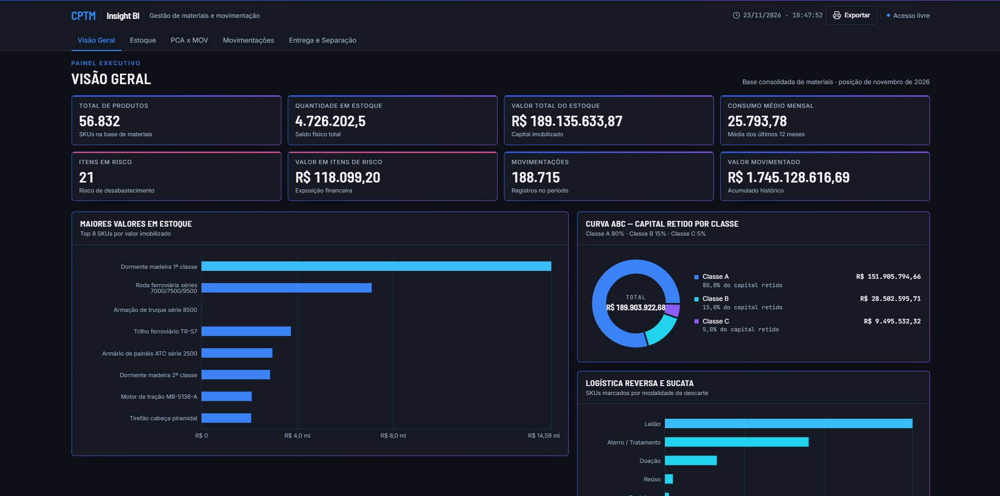
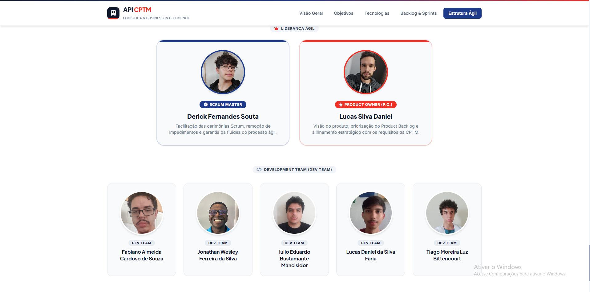
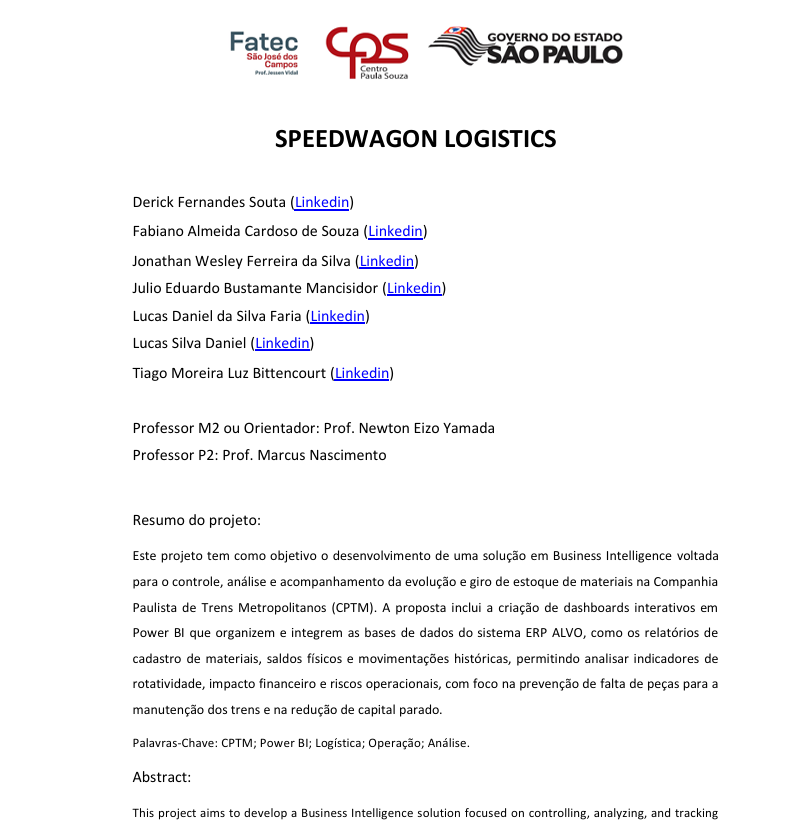

# 📌 MVP - SpeedWagon Logistics

## 🎯 Objetivo do MVP
> O objetivo é resolver a demora na identificação de riscos operacionais e a dificuldade de acesso rápido aos indicadores durante as vistorias em campo. Dessa forma, validamos a hipótese de que alertas visuais automatizados, projeções de demanda e uma interface otimizada para dispositivos móveis agilizam a tomada de decisão preventiva. O valor entregue é uma solução completa, mobile e autônoma, que permite prever o consumo dos próximos 3 meses, evitar paradas na manutenção e capacitar a equipe através de um manual e dicionário de dados.

---

## 📝 Descrição da Solução
> Nesta etapa, focaremos nas entregas finais de inteligência analítica e documentação da plataforma. Como funcionalidades principais, o MVP entregará alertas visuais, previsão de consumo para os próximos 3 meses, versão mobile com navegação rápida, além do manual do usuário e dicionário de dados. A principal limitação conhecida é que as projeções baseiam-se em histórico estático, sem conexão automática em tempo real com o ERP ALVO. Por fim, o escopo foi reduzido para garantir apenas a visibilidade preventiva, a mobilidade e a autonomia da equipe na operação do painel.  

---

## 👥 Personas / Usuários-Alvo
- **Persona 1:** Gerente de Logística da CPTM – Este perfil atua na gestão estratégica do abastecimento e controlo de materiais da empresa. A sua necessidade central envolve garantir que os dados brutos extraídos do ERP ALVO sejam devidamente limpos e estruturados, para assegurar que os futuros relatórios estejam livres de duplicidades e erros. As suas dores são atendidas nesta etapa através da apresentação de um protótipo de layout, permitindo-lhe aprovar a distribuição visual das informações de forma segura antes do desenvolvimento completo do dashboard.  
- **Persona 2:** Supervisor do Almoxarifado – Este perfil atua na gestão operacional diária e na organização física dos armazéns (galpões). A sua necessidade central é conseguir segmentar a base de dados, filtrando as informações especificamente por Almoxarifado, Período e Tipo de Material. As suas dores relativas ao excesso de informação desorganizada são resolvidas ao receber uma funcionalidade que lhe permite focar a análise exclusivamente nos dados referentes ao seu próprio galpão, facilitando o acompanhamento e a operação local.
- **Persona 3:** Analista de Compras – Este perfil atua no planejamento de aquisições e na negociação de novos contratos de materiais para a manutenção da frota. A sua necessidade central envolve ter visibilidade clara sobre o ranking de custos, a classificação da Curva ABC e a previsão de cobertura de estoque para os próximos meses. As suas dores ligadas à imprevisibilidade de demandas e compras urgentes são atendidas na medida em que a limpeza e estruturação dos dados do ERP neste MVP criarão a base confiável para que, nas próximas entregas, ele consiga planejar compras futuras com segurança e focar os esforços de negociação exclusivamente nos materiais mais críticos.

---

## 🔑 User Stories (Backlog do MVP)
| ID  | User Story                                                                 | Prioridade | Estimativa |
|-----|-----------------------------------------------------------------------------|------------|------------|
| US1 | Como Supervisor do Almoxarifado, quero receber alertas visuais sobre estoque parado há mais de 180 dias, risco de ruptura ou excesso, para agilizar a tomada de decisão nas oficinas.       | Alta       | 3   |
| US2 | Como Gerente de Logística da CPTM, quero acessar uma versão otimizada para dispositivos móveis com navegação rápida (até 2 cliques), para monitorar os indicadores de forma ágil durante as vistorias.         | Alta      | 13    |
| US3 | Como Analista de Compras, quero visualizar a cobertura de estoque e a previsão de consumo para os próximos 3 meses, para planejar compras futuras com segurança e evitar surpresas.         | Alta      | 8   |
| US4 | Como Gerente de Logística da CPTM, quero receber um manual do usuário e um dicionário explicativo dos dados, para garantir que a equipe saiba operar e manter o dashboard com autonomia.        | Média      | 5   |

---

## 📅 Sprint(s) Relacionadas
| Sprint | Entregas Principais                          | Status   |
|--------|----------------------------------------------|----------|
| 01     | quero que os dados brutos do ERP sejam limpos e estruturados                       | Concluído|
| 02     | quero que o layout aprovado seja implementado no Power BI com indicadores de Quantidade Total, Valor Imobilizado e Estoque Médio                          | Concluído |
| 02     | quero acompanhar o giro de estoque e o tempo médio de permanência dos materiais                          | Concluído |
| 03     | quero receber alertas visuais sobre estoque parado há mais de 180 dias, risco de ruptura ou excesso                           | Concluído |
| 03     | quero acessar uma versão otimizada para dispositivos móveis com navegação rápida (até 2 cliques)                           | Concluído |
| 03     | quero visualizar a cobertura de estoque e a previsão de consumo para os próximos 3 meses                           | Concluído |
| 03     | quero receber um manual do usuário e um dicionário explicativo dos dados                         | Concluído |

---

## 📊 Critérios de Aceitação
- O MVP deve permitir que o usuário visualize alertas visuais de estoque parado há mais de 180 dias, excesso ou risco de ruptura, consulte a previsão de consumo para os próximos 3 meses e acesse o painel em dispositivos móveis com navegação rápida (até 2 cliques).  
- O sistema deve registrar o cálculo automatizado da cobertura de estoque e das projeções de demanda, além de disponibilizar o manual do usuário e o dicionário explicativo dos dados para garantir a operação autônoma. 
- Métricas coletadas: Cobertura de estoque (dias), previsão de consumo trimestral, quantidade de itens em alerta crítico (parados >180 dias, ruptura ou excesso) e tempo/cliques de navegação na interface mobile.  

---

## 📈 Métricas de Validação
- Validação com Stakeholders: Número de apresentações e rodadas de homologação realizadas com o cliente (CPTM) e orientadores para aprovar os alertas visuais de risco, as projeções de consumo para 3 meses, a versão mobile e a documentação final (manual e dicionário de dados).  
- Avaliação de Usabilidade e Clareza: Coleta de percepções (feedback qualitativo) sobre a agilidade da navegação na interface mobile (em até 2 cliques) durante as vistorias, a clareza dos alertas de estoque parado ou ruptura e a compreensão do manual do usuário.  
- Aderência aos Objetivos de Negócio: Capacidade técnica do MVP em antecipar necessidades de reposição por meio da cobertura e previsão trimestral, prevenir paradas na manutenção das oficinas e garantir total autonomia da equipe na operação e manutenção do painel. 

---

## 🚀 Próximos Passos
- Preparação para a Feira de Soluções

---

## 📂 Anexos / Evidências
## Site

Link para Site: [https://magic-cptm-insight-flow.base44.app/](https://magic-cptm-insight-flow.base44.app/) 
---

## Visão Geral do Projeto

Link para Visão Geral do Projeto: [https://api-4-semestre-speedwagon-logistics.github.io/Speedwagonwebsite/](https://api-4-semestre-speedwagon-logistics.github.io/Speedwagonwebsite/) 
---

## Relatório do MVP
💡 *Clique na imagem abaixo para abrir o relatório completo em PDF.*

---

## Vídeo do MVP (Clique na imagem abaixo para assistir)

  

